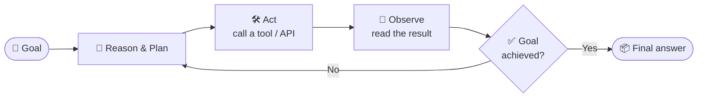
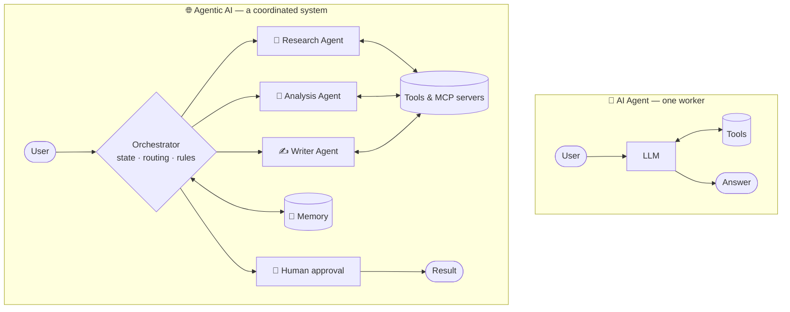
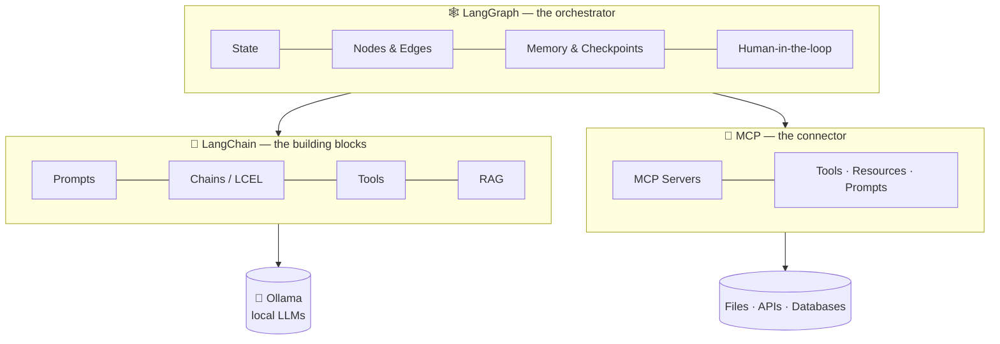
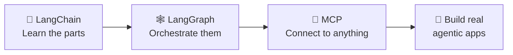
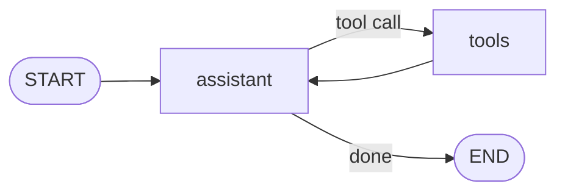
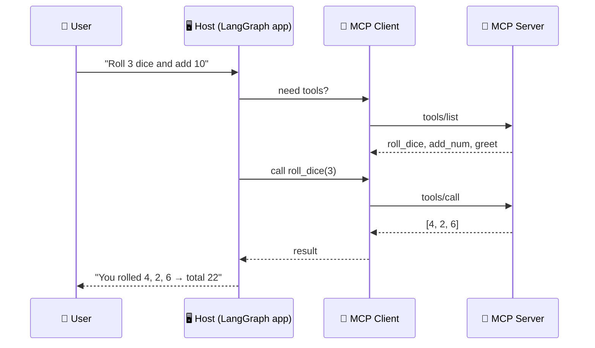
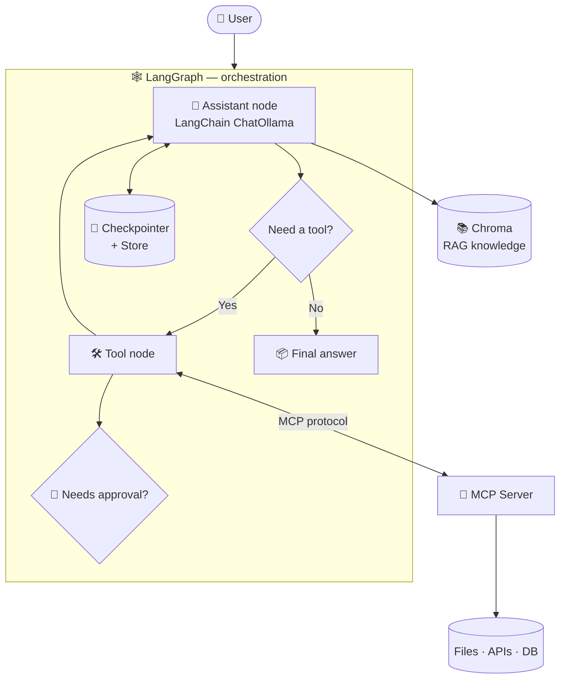

<div align="center">

# 🤖 Agentic AI

### From a single LLM call to autonomous, tool-using, stateful AI systems.

**A hands-on learning repository built with LangChain · LangGraph · MCP · Ollama**


[🧠 What is Agentic AI?](#-what-is-agentic-ai) ·
[⚔️ Agents vs Agentic AI](#️-ai-agents-vs-agentic-ai) ·
[🧰 The Stack](#-the-stack-in-this-repo) ·
[🗂️ Structure](#️-repository-structure) ·
[🚀 Quick Start](#-quick-start) ·
[🗺️ Roadmap](#️-learning-roadmap) ·
[🎯 Quiz](#-test-yourself)

</div>

---

## 🧠 What is Agentic AI?

Most people first meet AI as a **chatbot**: you ask, it answers, the conversation ends.

**Agentic AI** goes further. Instead of only *responding*, an agentic system can **pursue a goal**: it plans, decides what to do next, uses tools, observes the results, adjusts, and keeps going until the job is done.

> **In one sentence:** Agentic AI is AI that can **reason, plan, act, and adapt** with a degree of autonomy to accomplish a goal, rather than just generating a single reply.

### The core loop

Every agentic system, however fancy, is built around a loop like this:



### The building blocks

| Capability | What it means | Everyday analogy |
|---|---|---|
| 🧠 **Reasoning** | Break a goal into steps and decide what to do next | A chef reading a recipe and planning the order |
| 🛠️ **Tool use** | Call functions, APIs, databases, search, code | The chef using knives, oven, and timer |
| 💾 **Memory** | Remember the conversation (short-term) and facts (long-term) | The chef remembering you're allergic to nuts |
| 🔁 **Looping** | Retry, refine, and continue until done | Tasting and adjusting the seasoning |
| 🙋 **Human oversight** | Pause for approval before risky actions | Asking before serving a new dish to a guest |

<details>
<summary><b>👉 Click to see a concrete example</b></summary>

**Request:** *"Find out how TCP differs from UDP and give me a 3-line summary."*

| Step | Chatbot | Agentic system |
|---|---|---|
| 1 | Answers from whatever it memorized | **Plans:** "I should check the notes first" |
| 2 | — | **Acts:** searches the vector store (RAG) |
| 3 | — | **Observes:** reads the retrieved chunks |
| 4 | — | **Checks:** "Is this enough?" → searches again if not |
| 5 | Replies | **Replies** with a grounded, verified summary |

</details>

---

## ⚔️ AI Agents vs Agentic AI

These terms are often used interchangeably, but they sit at **different levels**.

- An **AI agent** is a *single* entity: an LLM + tools that completes a task.
- **Agentic AI** is the broader *paradigm / system design*: autonomy, planning, memory, and often **multiple** agents coordinating inside a controlled workflow.

> 🏠 **Analogy:** An **AI agent** is a skilled *employee*. **Agentic AI** is the whole *company*: employees, managers, processes, shared memory, and approval rules working toward a goal.

### Side-by-side comparison

| Dimension | 🤖 AI Agent | 🌐 Agentic AI |
|---|---|---|
| **What it is** | One LLM-driven entity with tools | A system/paradigm built on autonomy and orchestration |
| **Scope** | Narrow, task-focused | Broad, goal-focused |
| **Typical task** | "Check the weather and tell me" | "Plan my trip, book it, and handle changes" |
| **Planning** | Usually short, reactive steps | Multi-step plans, re-planning when things change |
| **Structure** | Single agent loop | Often multiple agents, routing, sub-workflows |
| **Memory** | Often just the current conversation | Short-term **and** long-term memory |
| **Control** | Model decides most steps | Explicit state, rules, retries, human approvals |
| **Example in this repo** | `14_agents.py`, `15_react_agent.py` | LangGraph graphs with loops, memory, HITL, subgraphs |

### Visual difference



<details>
<summary><b>💡 Rule of thumb (click to expand)</b></summary>

- If it's **one model calling a few tools** → it's an **AI agent**.
- If it involves **planning, memory, multiple steps/agents, retries, and oversight working together** → you're building **Agentic AI**.
- An agent is a *component*; agentic AI is the *architecture*.

</details>

---

## 🧰 The Stack in This Repo

In this repository we build agentic systems using **three** technologies, each with a clear job:



| Technology | Role | Think of it as | You'll learn |
|---|---|---|---|
| 🦜 **LangChain** | Components for talking to LLMs | **The toolbox** | Prompts, LCEL chains, output parsers, streaming, async, structured output, tools, agents, RAG |
| 🕸️ **LangGraph** | Stateful workflow orchestration | **The brain's flowchart** | State, conditional edges, loops, parallelism, checkpoints, short- and long-term memory, HITL, subgraphs, `ToolNode`, retries |
| 🔌 **MCP** | Standard protocol for connecting AI to tools & data | **The USB-C port for AI** | Host / Client / Server, Tools, Resources, Prompts, building servers with FastMCP |

> 💬 **How they fit together:** *LangChain* gives you the parts, *LangGraph* controls **when and why** each part runs, and *MCP* standardizes **how** your agent reaches the outside world.

Everything runs **locally and free** using [Ollama](https://ollama.com) for models and [ChromaDB](https://www.trychroma.com) for vector storage. No paid API key required.

---

## 🗂️ Repository Structure

```text
Agentic AI/
│
├── 📄 README.md              ← you are here
├── 📄 requirements.txt       ← all Python dependencies
├── 📄 .gitignore
│
├── 🦜 Langchain/             ← Step 1: the building blocks
│   ├── 01 – 05   Models, messages, prompts, LCEL, output parsers
│   ├── 06 – 08   Streaming, ainvoke, astream
│   ├── 09        Structured output
│   ├── 10 – 15   Tools, tool-calling loop, agents, ReAct
│   ├── 16 – 20   Documents → chunks → embeddings → Chroma → RAG chain
│   └── README.md             ← detailed LangChain guide
│
├── 🕸️ Langgraph/             ← Step 2: stateful agent workflows
│   ├── 01 – 04   First graph, tracing, conditional edges, loops
│   ├── 05 – 06   Parallel execution and reducers
│   ├── 07 – 09   Checkpointers, short-term & long-term memory
│   ├── 10        Human-in-the-loop
│   ├── 11 – 12   Streaming (incl. LLM streaming)
│   ├── 13 – 15   Subgraphs, ToolNode, tool exception handling
│   ├── 16 – 17   Retries, iteration limits, reusable tools (notes)
│   ├── langgraph_core_concepts_guide.md
│   └── README.md             ← detailed LangGraph guide
│
└── 🔌 MCP/                   ← Step 3: connect agents to the world
    ├── lesson1.md            ← foundations & architecture
    └── main.py               ← demo MCP server (FastMCP)
```

<details>
<summary><b>📖 Click to open the learning path as a diagram</b></summary>



</details>

---

## 🚀 Quick Start

### 1️⃣ Prerequisites

- **Python 3.10+**
- **[Ollama](https://ollama.com/download)** installed and running
- Two local models pulled:

```powershell
ollama pull llama3.2:3b
ollama pull nomic-embed-text
```

Verify:

```powershell
ollama list
```

### 2️⃣ Create a virtual environment and install dependencies

```powershell
# From the "Agentic AI" folder
python -m venv venv
.\venv\Scripts\Activate.ps1

pip install -r requirements.txt
```

<details>
<summary><b>🍎 / 🐧 macOS & Linux commands</b></summary>

```bash
python3 -m venv venv
source venv/bin/activate
pip install -r requirements.txt
```

</details>

<details>
<summary><b>⚠️ PowerShell blocks activation?</b></summary>

Skip activation and call the interpreter directly:

```powershell
.\venv\Scripts\python.exe .\Langchain\01_hello_world.py
```

</details>

### 3️⃣ Configure environment variables

Create a `.env` file inside the folder you're running scripts from (`Langchain/` and `Langgraph/`). The helper `utils.py` files read these values:

```env
MODEL=llama3.2:3b
EMBED_MODEL=nomic-embed-text
```

> 🔐 `.env` is already listed in `.gitignore`. Never commit secrets.

### 4️⃣ Run your first example

```powershell
cd Langchain
python 01_hello_world.py
```

Then try a graph:

```powershell
cd ..\Langgraph
python 01_first_graph.py
```

And start your first MCP server:

```powershell
cd ..\MCP
python main.py
```

---

## 🗺️ Learning Roadmap

Click each stage to expand it. Tick off boxes as you go (copy this README into your own notes to track progress).

<details>
<summary><b>🦜 Stage 1 — LangChain: the building blocks</b></summary>

**Goal:** understand how to talk to an LLM and give it tools and knowledge.

- [ ] Call a local model with `ChatOllama`
- [ ] Use system and human messages
- [ ] Build prompt templates and LCEL chains: `prompt | llm | parser`
- [ ] Stream output and use `ainvoke` / `astream`
- [ ] Get structured output with Pydantic
- [ ] Define tools with `@tool` and understand the tool-call cycle
- [ ] Build a simple agent (`create_agent`) and a ReAct agent
- [ ] Load documents → split → embed → store in Chroma
- [ ] Build an end-to-end **RAG chain**

```python
# The heart of LangChain: composable pipelines
chain = prompt | llm | StrOutputParser()
answer = chain.invoke({"topic": "TCP", "difficulty": "beginner"})
```

📘 Deep dive: [`Langchain/README.md`](./Langchain/README.md)

</details>

<details>
<summary><b>🕸️ Stage 2 — LangGraph: stateful, controllable workflows</b></summary>

**Goal:** turn loose agent behavior into explicit, debuggable workflows.

- [ ] Build your first `StateGraph` with nodes and edges
- [ ] Route with conditional edges
- [ ] Create loops with a safety limit
- [ ] Run nodes in parallel and merge with reducers
- [ ] Persist state with a **checkpointer** (`thread_id`)
- [ ] Add **short-term** (per-thread) and **long-term** (cross-thread) memory
- [ ] Pause for approval with **human-in-the-loop**
- [ ] Stream graph and LLM output
- [ ] Compose subgraphs
- [ ] Use `ToolNode` + `tools_condition` and handle tool errors
- [ ] Add retries and iteration limits

```python
# The heart of LangGraph: state + nodes + edges
builder = StateGraph(MessagesState)
builder.add_node("assistant", assistant)
builder.add_node("tools", ToolNode(tools))
builder.add_edge(START, "assistant")
builder.add_conditional_edges("assistant", tools_condition)
builder.add_edge("tools", "assistant")
graph = builder.compile()
```



📘 Deep dive: [`Langgraph/README.md`](./Langgraph/README.md) and [`langgraph_core_concepts_guide.md`](./Langgraph/langgraph_core_concepts_guide.md)

</details>

<details>
<summary><b>🔌 Stage 3 — MCP: connect agents to the outside world</b></summary>

**Goal:** expose and consume tools through a standard protocol.

- [ ] Explain Host, Client, and Server
- [ ] Distinguish **Tools**, **Resources**, and **Prompts**
- [ ] Compare Python functions, LangChain tools, REST APIs, and MCP
- [ ] Build an MCP server with FastMCP
- [ ] Connect an MCP server to a LangGraph agent
- [ ] Apply security basics: least privilege, validation, approvals

```python
# A complete MCP server in a few lines
from fastmcp import FastMCP

mcp = FastMCP(name="Demo-Mcp-Server")

@mcp.tool
def add_num(a: float, b: float) -> float:
    '''Add two numbers together'''
    return a + b

if __name__ == "__main__":
    mcp.run()
```



📘 Start here: [`MCP/lesson1.md`](./MCP/lesson1.md)

</details>

---

## 🧩 How It All Comes Together

A realistic agentic application uses **all three** layers at once:



| Layer | Handles |
|---|---|
| 🦜 LangChain | Model calls, prompts, tools, retrieval |
| 🕸️ LangGraph | Control flow, state, memory, loops, approvals |
| 🔌 MCP | Standardized access to external tools and data |

---

## 🎯 Test Yourself

<details>
<summary><b>Q1. What is the key difference between a chatbot and Agentic AI?</b></summary>

A chatbot *responds*. Agentic AI *pursues a goal*, planning, acting through tools, observing results, and looping until the goal is reached.

</details>

<details>
<summary><b>Q2. Is every AI agent "Agentic AI"?</b></summary>

Not quite. A single AI agent is a **component**. Agentic AI is the broader **system/paradigm** (planning, memory, orchestration, oversight, often multiple agents).

</details>

<details>
<summary><b>Q3. What problem does LangGraph solve that a basic agent loop doesn't?</b></summary>

It makes the workflow **explicit and controllable**: typed state, conditional routing, loops with limits, checkpoints, memory, retries, and human approval points.

</details>

<details>
<summary><b>Q4. What does MCP stand for, and why does it exist?</b></summary>

**Model Context Protocol.** It standardizes how AI applications discover and use external tools, resources, and prompts, so you don't write custom integration code for every app and service.

</details>

<details>
<summary><b>Q5. Does MCP replace LangChain or LangGraph?</b></summary>

No. They work at different layers: LangChain = components, LangGraph = orchestration, MCP = connectivity protocol.

</details>

---

## 🛠️ Troubleshooting

<details>
<summary><b>❌ <code>ModuleNotFoundError</code></b></summary>

Make sure the virtual environment is active, then reinstall:

```powershell
python -m pip install -r requirements.txt
```

</details>

<details>
<summary><b>❌ Ollama: model not found / connection refused</b></summary>

```powershell
ollama list
ollama pull llama3.2:3b
ollama pull nomic-embed-text
```

Also confirm the Ollama app/service is running, and that the model name in `.env` matches exactly.

</details>

<details>
<summary><b>❌ <code>MODEL</code> or <code>EMBED_MODEL</code> is <code>None</code></b></summary>

Your `.env` file is missing or in the wrong folder. Create it next to the scripts you're running (inside `Langchain/` or `Langgraph/`) with `MODEL=` and `EMBED_MODEL=` set.

</details>

<details>
<summary><b>❌ Small model calls the wrong tool or writes tool JSON as text</b></summary>

Small local models (like 3B) can be unreliable at tool calling. Use a clear system prompt, temperature `0`, validate tool inputs, and consider a larger model if needed.

</details>

<details>
<summary><b>❌ Chroma returns irrelevant results</b></summary>

Check that the collection name, persist directory, and **embedding model** match between indexing and querying. If you change any of them, rebuild `chroma_db/`.

</details>

---

## 🔐 Good Habits

- 🔑 Keep `.env` out of Git (already in `.gitignore`).
- 🧪 Validate tool arguments: the model *proposes*, your code *enforces*.
- 🛑 Add human approval before side effects (sending, deleting, paying).
- 🔁 Always set iteration limits on loops.
- 📦 Treat retrieved documents and tool output as **data**, not trusted instructions.
- 🔍 Print intermediate state: debug retrieval separately from generation.

---

## 🌱 What's Next

- [ ] Connect an MCP server to a LangGraph agent (`langchain-mcp-adapters`)
- [ ] Build an MCP server that searches this repo's lessons
- [ ] Add resources and prompts to the MCP server
- [ ] Build a multi-agent supervisor graph
- [ ] Add tracing and evaluation (LangSmith)
- [ ] Ship a capstone project that combines RAG + LangGraph + MCP

---

<div align="center">

### 🚀 Build. Inspect. Experiment. Repeat.

**The goal isn't to memorize APIs. It's to understand how an AI system thinks, acts, and stays under control.**

⭐ *If this repo helps you learn, give it a star!*

</div>
